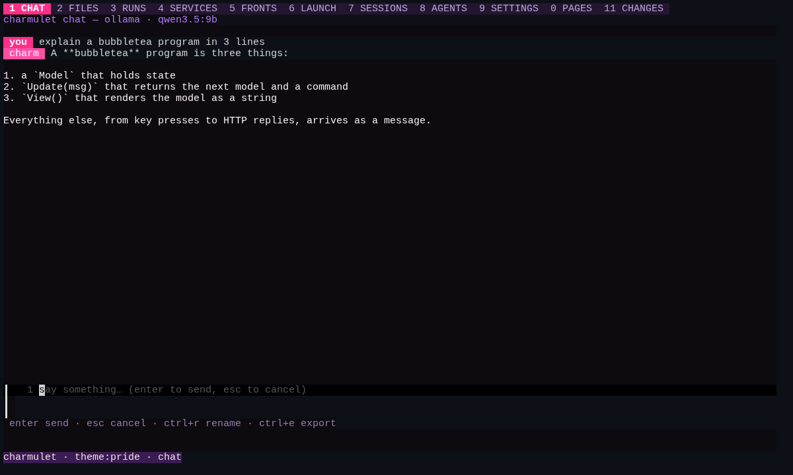
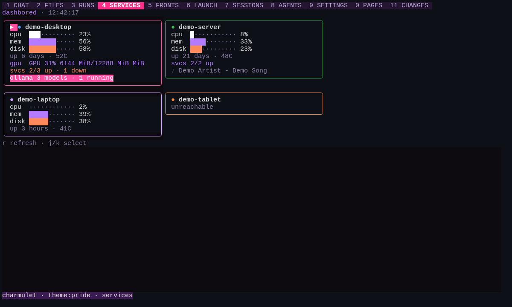
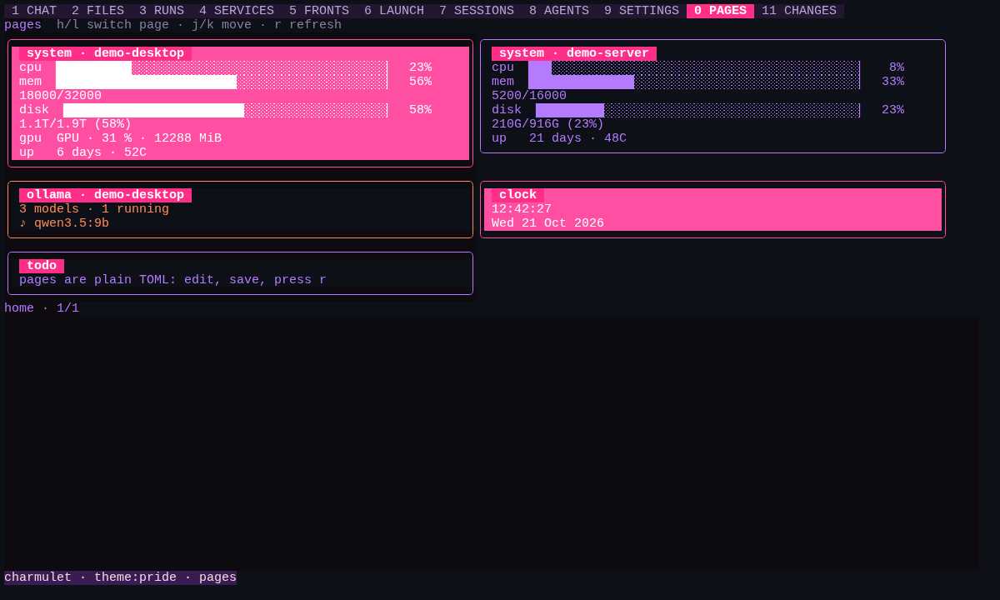
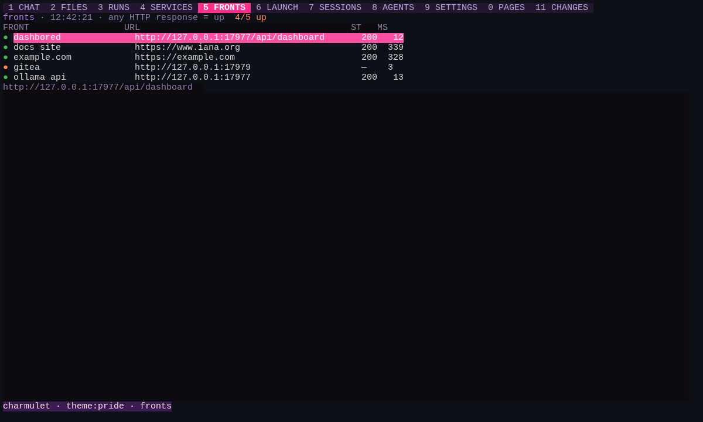
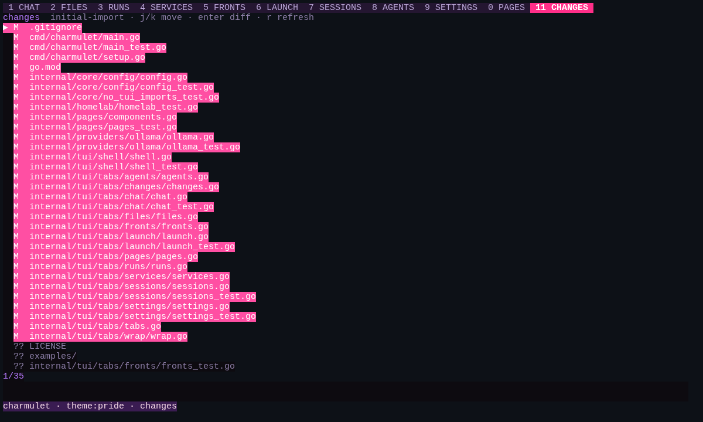

# CHARMULET

A terminal workbench for running local AI models, built in Go on the Charm
stack (Bubble Tea v2, Lip Gloss v2, Bubbles, Huh, Glamour).

One binary, eleven tabs. Chat with the models on your own ollama server, send
one prompt to several models at once, keep and resume conversations, edit agent
definitions, watch your machines and web services, and walk through your git
changes. All of it stays in one terminal window.

<p align="center"></p>

## Why

Running models at home means juggling a chat window, a model list, a
dashboard for the machines and a browser tab for every service. CHARMULET puts
those in one keyboard-driven place. It talks to the ollama server you already
have. It needs no cloud account and keeps no telemetry.

## What it does

| # | Tab | What it does |
| --- | --- | --- |
| 1 | CHAT | Streams answers from an ollama model. `enter` sends, `esc` cancels, `ctrl+r` renames the session, `ctrl+e` exports it to Markdown |
| 2 | FILES | File browser with a Markdown reader. `enter` opens, `esc` goes back |
| 3 | RUNS | Sends one prompt to several models side by side. `p` keeps the longest answer, `f` fuses them into one |
| 4 | SERVICES | Live cards for your machines: CPU, memory, disk, GPU and services, read from a [dashbored](#dashbored-feed) feed |
| 5 | FRONTS | Up/down and latency checks for a list of URLs, every 10 seconds |
| 6 | LAUNCH | Pick a model to open another chat tab, or start an agent CLI in docker (asks first) |
| 7 | SESSIONS | Every saved conversation. Pick one to resume it |
| 8 | AGENTS | Edit agent TOML files and switch skills on or off |
| 9 | SETTINGS | Switch theme live, with no restart |
| 0 | PAGES | Your own dashboard pages, laid out in TOML |
| 11 | CHANGES | `git status` of the current folder, with a diff for each file |

<p align="center">
  
  
</p>
<p align="center">
  
  
</p>

Conversations are saved in SQLite as you go, using a pure-Go driver, so no CGO
is needed. They survive restarts.

## Install and run

You need Go 1.25.8 or newer (an older `go` fetches it for you) and an [ollama](https://ollama.com) server you can
reach.

```sh
go install github.com/nviiiivn/charmulet/cmd/charmulet@latest
```

or build from a clone:

```sh
git clone https://github.com/nviiiivn/charmulet.git
cd charmulet
go build ./cmd/charmulet
./charmulet
```

Start it from the repo folder, or anywhere that has a `themes/` folder: the
palette is read from `themes/<name>.toml`, and without one you get the built-in
default colors.

The first time it runs with no config file, a short setup wizard asks for
your ollama URL, a chat model and a theme. Run `charmulet setup` to do it again.

```sh
charmulet                    # open the TUI
charmulet run                # same thing
charmulet setup              # run the setup wizard again
charmulet -T pride           # start with themes/pride.toml
charmulet -R notes           # resume the session whose title or model contains "notes"
charmulet -R last            # resume the newest session
charmulet -v                 # version
```

### Keys

`tab` / `shift+tab` move between tabs, `1`-`9` and `0` jump to a tab, `ctrl+w`
closes a tab you opened, `?` shows help. `esc` backs out of whatever is open
and never quits. `ctrl+q` or `ctrl+c` asks before quitting.

When a text box has something in it, digits and `?` are typed into the box
instead of jumping tabs.

## Configuration

Settings live in `~/.config/charmulet/`. Copy what you need from
[`examples/`](examples):

| File | What it is |
| --- | --- |
| `charmulet.toml` | theme, ollama URL, chat model ([example](examples/charmulet.example.toml)). A `.charmulet.toml` in the folder you start from overrides it |
| `fronts.toml` | the URLs FRONTS checks ([example](examples/fronts.example.toml)). Without it, FRONTS checks ollama and dashbored on localhost |
| `pages/*.toml` | PAGES dashboards ([example](examples/home.example.toml)). Widgets: `system`, `disk`, `ollama`, `clock`, `note` |
| `agents/*.toml` | agents: `name`, `model`, `system_prompt`, optional `wrapper` |
| `skills/*.md` | skills. Rename one to `.md.disabled` to switch it off |
| `wrappers/*.toml` | agent CLIs LAUNCH can run in docker ([example](examples/wrapper.example.toml)) |

Environment variables:

| Variable | Default |
| --- | --- |
| `CHARMULET_OLLAMA_URL` | `http://localhost:11434` (used when `charmulet.toml` has no `ollama_url`) |
| `CHARMULET_DASHBORED_URL` | `http://localhost:6900` |
| `CHARMULET_CONFIG_DIR` | `~/.config/charmulet` |
| `CHARMULET_DB` | `~/.local/share/charmulet/charmulet.db` |
| `CHARMULET_EXPORT_DIR` | `~/.local/share/charmulet/exports` |
| `CHARMULET_DOCKER_BIN` | `docker` |

### dashbored feed

SERVICES and PAGES read machine stats from `GET <CHARMULET_DASHBORED_URL>/api/dashboard`.
That URL comes from dashbored, a separate homelab dashboard. Any server that
returns the same JSON works:

```json
{
  "demo-server": {
    "display": "demo-server", "color": "#3fb950",
    "widgets": {
      "system":   {"cpu": "aarch64", "cpu_percent": 7.5, "memory_percent": 33,
                   "disk": "210G/916G (23%)", "disk_percent": 23, "uptime": "21 days", "temp": "48C"},
      "services": {"services": [{"name": "gitea", "port": "3100", "active": true}]},
      "ollama":   {"models": [{"name": "qwen3.5:9b"}], "running": ["qwen3.5:9b"]}
    }
  }
}
```

Without a feed, those two tabs show the feed error and the rest of
the app works as normal.

## Development

```sh
go build ./...
go vet ./...
go test ./...
gofmt -l .
```

`internal/core` (sessions, providers, agents, config) never imports
`internal/tui`, and a test checks that. The TUI is one front end on top of the
core, so an HTTP server mode can be added later without a rewrite. The full
design is in [BLUEPRINT.md](BLUEPRINT.md).

## Status

Early, version 0.1.0, and built for one person's homelab first. Chat, runs,
sessions, agents, pages, fronts and changes work, and each has tests. Not done
yet:

- cartridges (per-project document search). Only the data shape exists so far.
- the HTTP/SSE server mode
- built-in wrappers ship with no docker image. Add one in `wrappers/*.toml` before LAUNCH can start it.
- chat shows model output as plain text. Markdown is rendered in FILES only.

Issues and pull requests are welcome.

## License

[PolyForm Noncommercial 1.0.0](LICENSE). Free to use, change and share for any
noncommercial purpose. Nobody gets to sell it.
